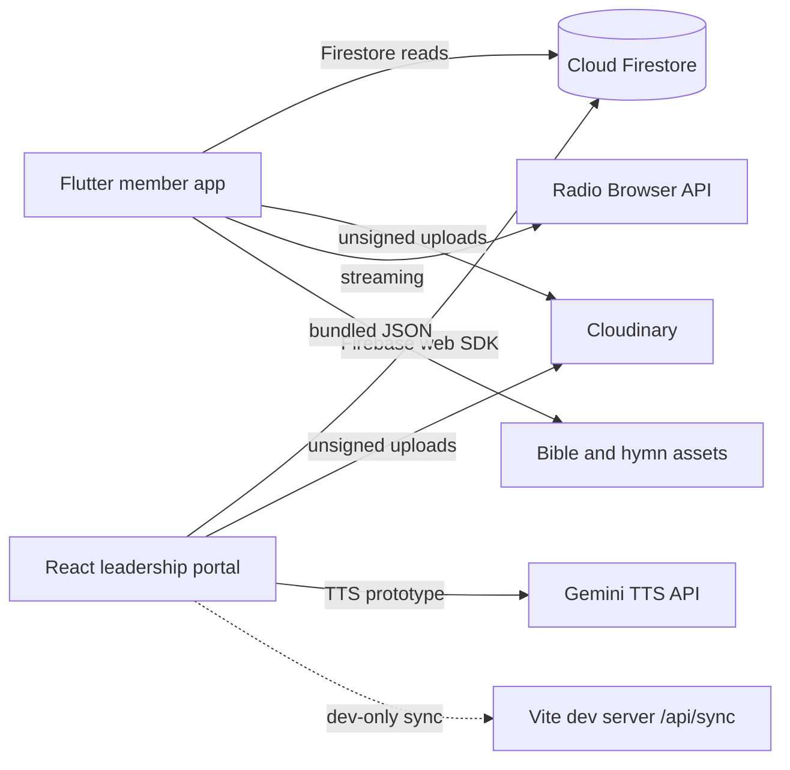
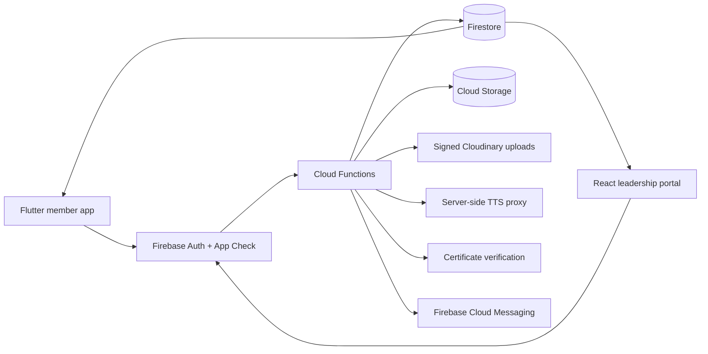

<div align="center">
  
</div>

<h1 align="center">Zion Jerusalem Church</h1>

<p align="center"><strong>A member app and leadership portal for one church family.</strong></p>

<p align="center">
  
  
  
  
  
</p>

<p align="center">
  
  
  
  
</p>

---

> **Current status: working prototype, not production-ready.**
>
> The Flutter app builds, its seven tests pass, and the React portal builds. Real authentication, safe Firestore writes, offline audio downloads, lock-screen playback, official PDFs, certificate verification, and engagement features are still being completed. See [Known limitations](#known-limitations) and the detailed [engineering plan](./PLAN.md) before using this with real member data.

> **Security notice:** this repository is public. Never commit `.env` files, service-account JSON, signing keystores, or API keys. The Cloudinary and Gemini credentials that were previously embedded in the source have been removed from the current tree, but they must still be rotated and old keys disabled.

---

## Contents

- [What this is](#what-this-is)
- [Current status](#current-status)
- [At a glance](#at-a-glance)
- [Two experiences, one church](#two-experiences-one-church)
- [Feature status](#feature-status)
- [Architecture](#architecture)
- [Technology](#technology)
- [Quick start](#quick-start)
- [Configuration](#configuration)
- [Project layout](#project-layout)
- [Security and privacy](#security-and-privacy)
- [Testing](#testing)
- [Design language](#design-language)
- [Roadmap](#roadmap)
- [Known limitations](#known-limitations)
- [Contributing](#contributing)
- [Church and contact](#church-and-contact)
- [License](#license)

---

## What this is

Zion Jerusalem Church is a church family in Mbagala, Dar es Salaam. This repository carries two connected products built around the everyday life of that church:

- **`zion_mobile`** is a Flutter app for members: Bible, hymns, sermons, radio, notes, events, prayer, and spiritual growth.
- **`zion-portal`** is a React and Vite web portal for pastors and leaders: communication, media, care follow-up, reports, and certificates.

The project is intentionally local in its language and structure. It is Swahili-first, recognises Jumuiya small groups, and is designed for the realities of a congregation that may be on a slow or intermittent connection.

It is not a generic church management product. It is one church's digital sanctuary: a place to meet the Word, stay close to the community, and do the behind-the-scenes work with care.

---

## Current status

| Area | Status | What that means today |
|---|---|---|
| Flutter member app | Prototype | Broad, navigable feature set; some features are local-only or still incomplete |
| React leadership portal | Prototype | Rich UI and content tooling, but demo authentication and mostly local/mock sync |
| Firebase data | Partial | Firestore reads and rules exist; reliable authenticated writes are not wired end to end |
| Offline experience | Partial | Bible and hymn assets are bundled; audio "downloads" are only recorded flags |
| Background audio | Planned | No real media session or Android foreground service yet |
| Reports and certificates | Partial | Browser-print views; no deterministic PDFs, registry, or QR verification |
| Tests | Partial | 7 Flutter tests; no portal tests or Firestore rules tests yet |
| Production readiness | Not ready | Complete the P0 security work in [PLAN.md](./PLAN.md) first |

The strongest parts of the project today are the product thinking, the breadth of the member experience, the offline Bible and hymn content, and the visual identity. The weakest parts are trust and durability: identity, permissions, reliable persistence, and real background media.

---

## At a glance

| | Member app | Leadership portal |
|---|---|---|
| **Audience** | Congregation and Jumuiya members | Pastors, department heads, Jumuiya leaders, editors |
| **Platform** | Flutter, Android-first | React SPA, desktop-first and responsive |
| **Purpose** | Worship, Word, connection, growth | Publishing, care, media, reporting, oversight |
| **Entry point** | `zion_mobile/lib/main.dart` | `zion-portal/src/main.tsx` |
| **Current build** | `dart analyze lib` passes; `flutter test` 7/7 | `npm run build` passes; `npm run lint` passes with warnings |
| **Backend** | Firestore + bundled assets | Firestore + Cloudinary + optional Gemini TTS |
| **Known blocker** | Offline downloads and background audio | Authentication and safe writes |

---

## Two experiences, one church

### Walk with the Word

The member app brings Scripture and worship into daily life: the Bible in Swahili, the Tenzi za Rohoni hymn collection, sermons, Christian radio, personal notes, and reading progress. The Bible and hymn text are bundled, so they remain available when the network does not. The long-term offline promise is stronger audio and sermon downloads, not just a saved flag.

### Stay connected

Announcements, events, prayer requests, and Jumuiya life belong together. The app is designed as a quiet, low-friction home screen for the church week, with a path back to the congregation even when the user cannot attend in person.

### Lead with clarity

The portal is the church's operations desk. It is where leaders publish the things the congregation needs to see, follow up on care, manage sermon media, prepare reports, and issue certificates. The current portal shows the intended workflows; the security and persistence layers are the next major build.

---

## Feature status

Status key:

- **Working** - the current code path exists and is expected to work today, noting any internet or local-only caveat.
- **Partial** - the UI or a piece of the flow exists, but the production path is mock, local, or incomplete.
- **Planned** - part of the roadmap; not available yet.

| Feature | Status | Notes |
|---|---|---|
| Bible reading | Working | Bundled JSON assets; no login required |
| Bible search and bookmarks | Working | Local reading experience |
| Tenzi za Rohoni hymns | Working | Bundled offline hymn content |
| Personal notes | Working | Local notes with PDF/share export |
| Text-to-speech reading | Partial | Device TTS; quality and controls vary by platform |
| Christian radio | Working with internet | Radio Browser directory; needs better offline and error states |
| Sermons and media | Partial | Media hub is primarily custom/admin content; no in-app video player |
| Announcements and events | Partial | Portal and app surfaces exist; production write path is not reliable |
| Prayer requests | Partial | Privacy model needs to be fixed before real use |
| Jumuiya/discipleship growth | Partial | Milestones are stored as local flags |
| Offline audio downloads | Planned | Current Bible "download" only stores a SharedPreferences flag |
| Lock-screen audio | Planned | No media session or Android foreground service yet |
| Local notifications | Partial | Device notifications only; no FCM push pipeline |
| Portal dashboard | Partial | Strong visual shell; metrics and sections include demo/local data |
| Official reports | Partial | HTML print views; no deterministic PDF or issuance record |
| Certificates | Partial | Demo recipient data and serials; no registry or QR verification |
| Firebase Authentication | Planned | Portal uses local demo users today |
| Cross-device sync | Partial | Firestore is present, but writes and conflict handling are incomplete |
| Bible games and streaks | Planned | Not implemented |
| Automated test coverage | Partial | 7 Flutter tests; portal and rules tests still to add |

### A note on "working"

A screen is not "working" just because it opens. In this repository, a feature is only considered complete when it has a real data path, a visible failure state, role enforcement where needed, and a test at the level of risk. The [definition of done](./PLAN.md#15-definition-of-done) in the plan is the standard the project should be held to.

---

## Architecture

### What exists today



Important reality checks:

- The dotted Vite sync path is a development convenience. It is an in-memory server and does not exist in a static production build.
- The portal currently uses a local demo session, while the Firestore rules expect a real Firebase Auth user.
- Cloudinary uploads are unsigned. They should become server-signed before production.
- Gemini TTS is a client-side prototype. Browser-embedded keys are visible to anyone, even when supplied through Vite environment variables.

### What the system is becoming



The target is a server-authoritative system: the client may read and propose changes, but roles, scores, upload signatures, official serials, and sensitive writes are decided by trusted server code. The full sequence is in [PLAN.md](./PLAN.md).

---

## Technology

### Member app

| Layer | Choice |
|---|---|
| Framework | Flutter `3.47.2` / Dart `3.13.2` |
| UI | Material 3, Google Fonts, custom glass and navy/gold design language |
| Local data | `shared_preferences` today; SQLite/Drift is the planned migration for domain data |
| Audio | `audioplayers`, `flutter_tts`, `flutter_local_notifications` |
| Documents | `pdf`, `printing`, `share_plus` |
| Network | `http`, `url_launcher`, Firebase Core, Cloud Firestore |
| Media | `image_picker`, Cloudinary unsigned uploads |
| Content | Bundled Bible JSON and Tenzi za Rohoni hymn JSON |

### Leadership portal

| Layer | Choice |
|---|---|
| Framework | React `19.2` + TypeScript `6.0` |
| Build | Vite `8.2` |
| Styling | Hand-built design system; no component library dependency |
| Icons and motion | `lucide-react`, `canvas-confetti` |
| Backend SDK | Firebase JS SDK `12.19` |
| Linting | `oxlint` |
| Hosting config | `firebase.json`; a Vercel config is also present, but the chosen production host must be one |

### Shared services

| Service | Current role | Production concern |
|---|---|---|
| Cloud Firestore | Church content and records | Auth, rules, real write paths, backup |
| Firebase Hosting | Portal deployment target | Choose one host and remove competing configs |
| Cloudinary | Sermon/media and image uploads | Signed uploads, preset restrictions, key rotation |
| Gemini API | Text-to-speech prototype | Server proxy, quota, App Check, cost cap |
| Radio Browser | Online Christian radio directory | Cache, fallbacks, and a curated church list |
| Firebase Cloud Messaging | Planned push notifications | Token lifecycle, topics, consent |

---

## Quick start

### Prerequisites

- Flutter `3.47` or newer, with Android Studio and an Android device or emulator
- Node.js `20` or newer and npm
- Git
- Optional: Firebase CLI for rules and hosting work

### Clone

```bash
git clone https://github.com/mwijay12/zion-tz.git
cd zion-tz
```

### Run the leadership portal

```bash
cd zion-portal
npm install
cp .env.example .env.local
npm run dev
```

On PowerShell, use `Copy-Item .env.example .env.local` instead of `cp`.

The portal defaults to the church's unsigned Cloudinary cloud and preset. Override them in `.env.local` when needed. The Gemini TTS field is optional; without it, the prototype should fail gracefully rather than expose a key.

The portal login is a UI prototype: choose a role to enter. It does not verify a password or identity.

Build and lint:

```bash
npm run build
npm run lint
```

### Run the member app

```bash
cd zion_mobile
flutter pub get
dart analyze lib
flutter test
flutter run
```

To experiment with the optional Gemini wisdom feature locally:

```bash
flutter run --dart-define=GEMINI_API_KEY=your_local_key
```

Never put a real key in a committed file or a public build. Production must call a server-side proxy.

The church-admin demo is disabled unless a demo password is supplied:

```bash
flutter run --dart-define=ADMIN_DEMO_PASSWORD=choose_a_demo_password
```

`--dart-define` values are recoverable from the app. This gate is for local demonstration only; never reuse a real password.

### Firebase

The repository includes Firebase configuration for the existing project. Before deploying:

1. Confirm that you are using the correct Firebase project.
2. Enable Authentication and deploy tested rules.
3. Deploy only from a machine with the correct credentials.
4. Do not run `firebase deploy` against production while the current authentication work is incomplete.

---

## Configuration

| Variable or file | Where | Sensitive? | Notes |
|---|---|---|---|
| `VITE_CLOUDINARY_CLOUD_NAME` | `zion-portal/.env.local` | No | Public cloud name |
| `VITE_CLOUDINARY_UPLOAD_PRESET` | `zion-portal/.env.local` | No | Unsigned preset; must be tightly scoped |
| `VITE_GEMINI_TTS_KEYS` | `zion-portal/.env.local` | Yes | Local prototype only; never expose a key in production |
| `GEMINI_API_KEY` | `flutter run --dart-define` | Yes | Optional local feature; use a server proxy in production |
| `ADMIN_DEMO_PASSWORD` | `flutter run --dart-define` | No | Enables the local church-admin demo; recoverable, demo-only, never a real password |
| `google-services.json` | `zion_mobile/android/app/` | No | Firebase Android configuration |
| `firebase_options.dart` | `zion_mobile/lib/` | No | Public Firebase client configuration |
| `firestore.rules` | Repository root | No | Access control; must be reviewed and tested |
| `.env.example` | `zion-portal/` | No | Documents required variables without secrets |

Rules for contributors:

- `.env`, `.env.local`, real API keys, service-account JSON, `key.properties`, and signing files must never be committed.
- Anything prefixed with `VITE_` is embedded in the browser bundle. It is not a secret.
- Anything passed with `--dart-define` can be recovered from the app. It is not a secret.
- Cloudinary upload presets are not authentication. Restrict them and use signed uploads for privileged content.

---

## Project layout

```text
zion-tz/
|-- README.md                  This document
|-- PLAN.md                    Prioritized engineering and product plan
|-- docs/
|   `-- assets/
|       `-- hero.svg           Animated README banner
|-- zion_mobile/               Flutter member app
|   |-- lib/
|   |   |-- core/              Services, theme, shared models
|   |   `-- features/          Bible, hymns, media, radio, notes, growth, navigation
|   |-- assets/                Bible JSON, hymn JSON, images, icons
|   |-- android/               Android project and Firebase config
|   |-- test/                  Flutter tests
|   `-- pubspec.yaml
|-- zion-portal/               React leadership portal
|   |-- src/
|   |   |-- components/        Portal views and print templates
|   |   |-- services/          Firebase, sync, media, TTS, backup
|   |   |-- App.tsx            Application shell
|   |   `-- main.tsx           Entry point
|   |-- public/                Static images and Bible content
|   |-- .env.example           Environment template
|   |-- package.json
|   `-- vite.config.ts
|-- firebase.json              Firebase deployment configuration
|-- firestore.rules            Firestore access rules
|-- firestore.indexes.json     Firestore query indexes
`-- .gitignore                 Secrets, builds, APKs, logs, local state
```

Large reference prototypes (`elisha-master/`, `flutter_church_app_ui-master/`), APKs, logs, and local agent state are intentionally ignored. They are not part of the shipped product.

---

## Security and privacy

This project handles prayer requests, visitor follow-up, member details, and official church documents. Treat that data as pastoral, not as marketing data.

**Before any real deployment:**

1. Complete the authentication and Firestore rules work in Phase 1 of [PLAN.md](./PLAN.md).
2. Rotate the Cloudinary and Gemini credentials that existed in earlier source.
3. Keep the local demo login and dev-only sync service out of production builds.
4. Confirm that anonymous users cannot read member, prayer, visitor, report, or certificate data.
5. Add audit logging and a retention policy for sensitive records.
6. Obtain consent and publish a privacy notice in Swahili and English.
7. Verify the licence for the bundled Bible translation and all hymn/media content.
8. Do not add online giving without a separate payment-security review.

The current repository is **not safe for real member data**. The public demo UI is not the same thing as a secure pastoral system.

Security priorities are tracked as P0 in the plan. They are release blockers, not polish.

---

## Testing

Last verified on 20 October 2026.

| Check | Command | Result |
|---|---|---|
| Portal production build | `cd zion-portal && npm run build` | Passes; ~973 kB main JS (~273 kB gzip) |
| Portal lint | `cd zion-portal && npm run lint` | Passes with 18 warnings |
| Mobile static analysis | `cd zion_mobile && dart analyze lib` | No issues |
| Mobile tests | `cd zion_mobile && flutter test` | 7/7 passing |
| Firestore rules tests | Not yet present | Planned in Phase 1 |
| Portal tests | Not yet present | Planned in Phase 1 and 5 |

Known build attention points:

- The portal has oversized JavaScript and image assets.
- `churchDataBackupService` and `firebaseChurchService` have ineffective dynamic imports.
- Some catch blocks and React render logic produce lint warnings.
- `flutter analyze` can be slow on a first full run; `dart analyze lib` is the current quick check.

Do not treat a passing build as a passing release. The security and product checks in the plan are the real gate.

---

## Design language

The visual system is built around a **midnight sanctuary**: deep navy, warm gold, soft light, and restrained glass surfaces. The member app carries most of the atmosphere; the portal is calmer and more administrative, so leaders can scan information quickly.

Principles:

- Clarity before decoration.
- Gold is an accent, not a background for long text.
- Motion is slow and purposeful; reduced-motion preferences are respected.
- Swahili typography and long words must fit without clipping.
- Low-end Android devices are part of the design target, not an afterthought.

The animated banner at the top of this README lives in `docs/assets/hero.svg`. It has a static-friendly composition and respects `prefers-reduced-motion`.

---

## Roadmap

The full plan, acceptance criteria, data model, risks, and release gates are in [PLAN.md](./PLAN.md).

| Phase | Focus | Outcome |
|---|---|---|
| 0. Stabilise | Secrets, docs, repository hygiene | A clean, honest, safe-to-share baseline |
| 1. Identity and data | Firebase Auth, custom claims, rules, real writes | Only the right people can read and change data |
| 2. Media and offline | Lock-screen audio, downloads, local database, sync queue | The app works on a weak connection and in the background |
| 3. Official documents | Deterministic PDFs, certificate registry, QR verification | Reports and certificates are trustworthy |
| 4. Engagement | Streaks, quizzes, challenges, badges, moderation | Daily Scripture engagement without manipulation |
| 5. Launch readiness | Tests, CI, monitoring, accessibility, store release | A supported public release |

The next work is not a redesign. It is the unglamorous, high-value work of identity, permissions, persistence, and background reliability.

---

## Known limitations

- **Authentication is a demo:** the portal uses a local role selector and verifies no credentials. It is not a security boundary; do not use it with real data.
- **Writes can fail silently:** Firestore writes generally require authentication, while the current client is unauthenticated.
- **Sync is not production-ready:** the Vite `/api/sync` endpoints are in-memory development tools and are absent on a static host.
- **Offline audio is not real:** the Bible screen records download flags, not downloaded audio files.
- **Lock-screen playback is incomplete:** notification callbacks exist, but there is no proper media session or foreground service.
- **Reports are print views:** official PDF generation, signing, and issuance records are not implemented.
- **Certificates are demos:** the issue form is not backed by persisted records, serials, a registry, or a verification page.
- **Video is external:** media links open outside the app; there is no in-app player.
- **Push is local only:** FCM is not wired.
- **Gamification is absent:** no streaks, quizzes, challenges, badges, or leaderboards exist yet.
- **Test coverage is thin:** there are no portal tests, rules tests, or end-to-end release tests.
- **Licensing is unverified:** the bundled Bible translation, hymns, images, and media need rights review before public distribution.
- **No open-source licence:** the repository is public for transparency and access, not a grant to reuse church content or branding.

---

## Contributing

This is a church-owned project. Contributions should protect the congregation first.

- Never commit secrets or real member data.
- Work on a branch and open a pull request; do not push directly to `main`.
- Run the portal build/lint and the mobile analyze/test commands before asking for review.
- Add tests for security rules, permissions, sync, and official documents.
- Do not mark a feature "working" until its failure, offline, and permission states exist.
- Update this README and [PLAN.md](./PLAN.md) when a status changes.
- Follow the design language and the Swahili copy review process.
- For content, record the source and licence of every Bible, hymn, image, and media asset.

If you are reviewing a pull request, ask three questions: can the wrong person access this, what happens when the network fails, and what happens when the user makes a mistake?

---

## Church and contact

**Zion Jerusalem Church**  
Mbagala, Dar es Salaam, Tanzania

For repository access, deployment credentials, or church data questions, contact the repository owner or the church's designated technology lead. Do not post member information in a public issue.

---

## License

No open-source licence is currently granted. The church name, branding, member data, Bible and hymn content, media, and official documents are not licensed for reuse. A licence should only be added after the church makes an explicit decision.

The app is built with open-source tools; those tools remain under their respective licences.
